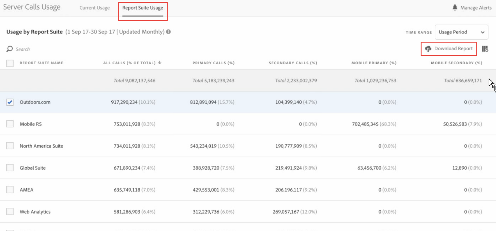
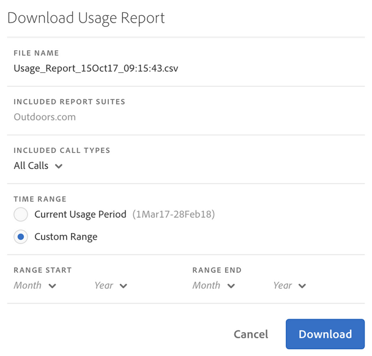
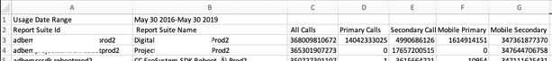

# Anzeigen der Nutzung der Report Suite

Die Registerkarte „Nutzung der Report Suite“ bietet Daten über die Server-Nutzung jeder Report Suite aller Anmeldeunternehmen innerhalb der aktuellen Nutzungsperiode, die mit Ihrem Abrechnungsunternehmen zusammenhängen.

**[!UICONTROL Analytics]** > **[!UICONTROL Admin]** > **[!UICONTROL Nutzung der Server-Aufrufe]** > **[!UICONTROL Nutzung der Report Suite]**

>[!IMPORTANT]
>
>Wenn eine Report Suite nicht mit einer Adobe-Organisation verknüpft ist, werden ihre Nutzungsdaten nicht in diesem Dashboard angezeigt. Außerdem kann eine Abrechnungs-ID mit mehreren Organisationen verknüpft sein. Es besteht nicht immer eine 1:1-Beziehung zwischen einer Organisation und einer Abrechnungs-ID.

Das Report Suite-Nutzungs-Dashboard

* Zeigt die Nutzung der Server-Aufrufe durch den aktuellen Nutzungszeitraum (alle Aufrufe, Primär, Sekundär, mobil, Primär, mobil Sekundär) für jede Report Suite in Ihrem Unternehmen.
* Zeigt den Prozentsatz der Gesamtauslastung pro Server-Aufrufkategorie.
* Wird täglich aktualisiert.
* Ist herunterladbar.
* Lässt Sie auf die Benutzeroberfläche **[!UICONTROL Warnhinweise verwalten]** zugreifen.

## Dashboard-Einstellungen {#settings}

| Spalte | Definition |
|--- |--- |
| Report Suite-Name | Anzeigename der Report Suite |
| Alle Aufrufe (% der Gesamtheit) | Alle Server-Aufrufe, die im aktuellen Nutzungszeitraum anfallen. |
| Primäre Aufrufe (%) | Alle primären Server-Aufrufe (und ihr Prozentsatz der Gesamtheit), die im aktuellen Nutzungszeitraum getätigt wurden. |
| Sekundäre Aufrufe (%) | Alle sekundären Server-Aufrufe (und ihr Prozentsatz der Gesamtheit), die im aktuellen Nutzungszeitraum getätigt wurden. |
| Primär für Mobilgeräte (%) | Alle im aktuellen Nutzungszeitraum angefallenen mobilen primären Server-Aufrufe (und deren Prozentsatz an der Gesamtsumme). |
| Sekundär für Mobilgeräte (%) | Alle im aktuellen Nutzungszeitraum angefallenen sekundären Server-Aufrufe für Mobilgeräte (und ihr Prozentsatz an der Gesamtsumme). |

{style="table-layout:auto"}

## Nutzungsbericht herunterladen {#download}

Mit dieser Option können Sie Nutzungsdaten und Daten aus Zeiträumen vor der aktuellen Nutzungsperiode herunterladen (bis Januar 2015). Der Bericht wird als CSV-Datei heruntergeladen.

1. Wählen Sie mindestens eine Report Suite.
1. Klicken Sie auf **[!UICONTROL Bericht herunterladen]**.

   

| Berichtselement | Beschreibung |
|--- |--- |
| Dateiname | Hartkodierter Name: Gebrauchsbericht `day and time of report creation.csv` |
| Enthaltene Report Suites | Alle Report Suites, die Sie auf der Seite Nutzung des Berichtsservers ausgewählt haben, sind in dieser Liste enthalten. |
| Enthaltene Aufruftypen | Legen Sie eine beliebige Kombination aus Folgendem fest: Alle Aufrufe (Standard), Primär, Sekundär, Mobile primär, Mobile sekundär. |
| Zeitraum | Sie können die aktuelle Nutzungsperiode auswählen oder einen benutzerdefinierten Zeitraum festlegen.  Für einen benutzerdefinierten Zeitraum geben Sie den Zeitraumbeginn und das Zeitraumende an.  **Hinweis:** Sie können keine Nutzungsdaten herunterladen, die vor Januar 2015 aufgezeichnet wurden . |

{style="table-layout:auto"}

1. Klicken Sie auf **[!UICONTROL Herunterladen]**.

Im Folgenden sehen Sie einen Screenshot, wie die heruntergeladene .csv-Datei aussieht. Sie enthält eine Spalte für die Report Suite-ID. Die Report Suite-ID gibt eine eindeutige ID an, die nur alphanumerische Zeichen enthalten darf. Diese ID kann nach der Erstellung einer Report Suite nicht mehr geändert werden.

