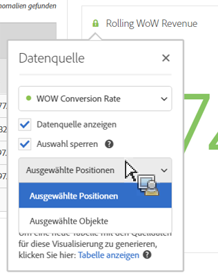
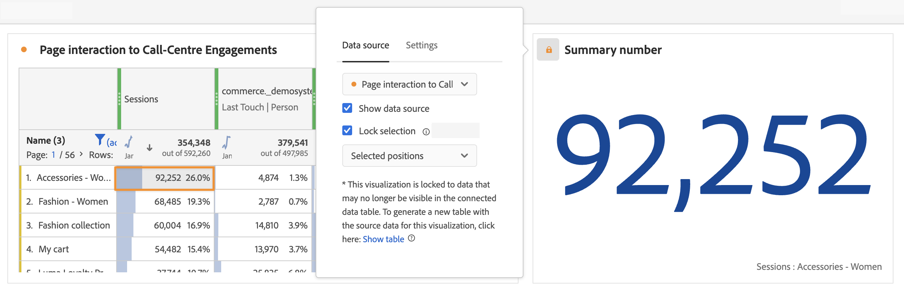

# Verwalten von Datenquellen {#manage-data-sources}

>[!CONTEXTUALHELP]
>id="workspace_freeformtable_lockselection"
>title="Auswahl sperren"
>abstract="Aktivieren Sie diese Einstellung, um die Visualisierung an den ausgewählten Positionen oder den ausgewählten Elementen in der Datenquelle zu sperren."

>[!CONTEXTUALHELP]
>id="workspace_freeformtable_lockselection_showtable"
>title="Tabelle anzeigen"
>abstract="Wenn Sie **[!UICONTROL Tabelle anzeigen]** auswählen, wird eine neue Datenquelle für Ihre aktuelle Visualisierung generiert, die von der ursprünglichen Datenquelle getrennt ist."

>[!CONTEXTUALHELP]
>id="workspace_freeformtable_showtable"
>title="Tabelle anzeigen"
>abstract="Wählen Sie **[!UICONTROL Tabelle anzeigen]** aus, um eine neue Datenquelle für Ihre aktuelle Visualisierung zu generieren, die von der ursprünglichen Datenquelle getrennt ist."

Jede Visualisierung in Analysis Workspace basiert auf einer Datenquelle, normalerweise einer Freiformtabelle. Durch das Synchronisieren von Visualisierungen können Sie steuern, welche Freiformtabelle oder Datenquelle einer Visualisierung entspricht und ob die Visualisierung für bestimmte Zeilen in dieser Tabelle gesperrt bleibt.

>[!TIP]
>
>Die Farbe von  neben dem Titel der Visualisierungen gibt an, welche Visualisierungen zusammenhängen. Übereinstimmende Farben besagen, dass Visualisierungen auf derselben Datenquelle basieren.
>

<!--
**Tip:** You can tell which visualizations are related by the color of the dot next to the title. Matching colors mean that visualizations are based on the same data source.

Managing a data source lets you show the data source or lock the selection. These settings determine how the visualization changes (or doesn't change) when new data comes in.

1. [Create a project](/help/analyze/analysis-workspace/home.md) with a data table and a [visualization](/help/analyze/analysis-workspace/visualizations/freeform-analysis-visualizations.md).
1. In the data table, select the cells (data source) you want to associate with the visualization.
1. In the visualization, click the dot next to the title to bring up the **[!UICONTROL Data Source]** dialog. Select **[!UICONTROL Show Data Source]** or **[!UICONTROL Lock Selection]**.

   

   Synchronizing a visualization to a table cell creates a new (hidden) table and color-codes the synchronized visualization with that table.

>[!BEGINSHADEBOX]

See  [Data source settings](https://video.tv.adobe.com/v/23729?quality=12&learn=on){target="_blank"} for a demo video.

>[!ENDSHADEBOX]

-->

## Datenquelleneinstellungen konfigurieren {#configure}

1. Wechseln Sie in Analysis Workspace zu der Visualisierung, deren Datenquelle oder Sperreinstellungen Sie konfigurieren möchten.

1. Bewegen Sie den Mauszeiger über die Visualisierung und wählen Sie dann das Symbol **[!UICONTROL Einstellungen]** (.

1. Wählen Sie die **[!UICONTROL Datenquelle]** aus.

   

1. Konfigurieren Sie eine der folgenden Einstellungen:

   | Einstellung | Beschreibung |
   | --- | --- |
   | **[!UICONTROL Datenquelle]** | Wählen Sie die Datenquelle aus, auf der die Visualisierung basiert. |
   | **[!UICONTROL Verknüpfte Visualisierungen]** | Listet alle mit der Datenquelle verknüpften Visualisierungen auf (Freiformtabelle). |
   | **[!UICONTROL Datenquelle zeigen]** | Ein- oder Ausblenden der Datenquelle (Freiformtabelle), die der Visualisierung entspricht. |
   | **[!UICONTROL Auswahl sperren]** | Sperren Sie die Visualisierung für die derzeit in der Datenquelle ausgewählten Zeilen und wählen Sie dann **[!UICONTROL Ausgewählte Positionen]** oder **[!UICONTROL Ausgewählte Elemente]** aus. Siehe [Auswahl sperren](#lock-selection). |

## Auswahl sperren {#lock-selection}

Durch das Sperren der Auswahl wird die Visualisierung weiterhin auf die Zeilen fokussiert, die Sie in der Datenquelle auswählen, auch wenn sich die Tabelle ändert. Beispielsweise ändert sich die Tabelle, wenn Sie sie sortieren oder filtern, ihren Datumsbereich ändern oder ein Segment anwenden. Eine gesperrte Visualisierung zeigt  neben dem Titel an.

Wenn sich die Segmente, Dimensionen oder Metriken in der Datenquelle ändern und die gesperrten Daten nicht mehr sichtbar sind, wählen Sie **[!UICONTROL Tabelle anzeigen]** aus, um eine neue, von der ursprünglichen Datenquelle getrennte Datenquelle für die Visualisierung zu generieren.

Wenn Sie die Auswahl sperren, wählen Sie eine der folgenden Optionen:

| Option | Beschreibung |
| --- | --- |
| **[!UICONTROL Ausgewählte Positionen]** | Sperrt die Visualisierung für die **Positionen** der in der Datenquelle ausgewählten Zeilen. Diese Positionen werden weiterhin visualisiert, auch wenn sich die Elemente in ihnen ändern. Wählen Sie beispielsweise diese Option aus, um immer die fünf häufigsten Kampagnennamen in der Datenquelle anzuzeigen, unabhängig davon, welche Kampagnen es sind.  Wenn Sie Aufschlüsselungszeilen sperren und diese Zeilen nicht mehr in der Tabelle enthalten sind, wird die Visualisierung nicht angezeigt. Um sie erneut anzuzeigen, aktualisieren Sie die Tabelle (z. B. ihr Datumsbereich, ihre Segmente oder Filter) oder aktualisieren Sie die Sperrauswahl. |
| **[!UICONTROL Ausgewählte Elemente]** | Sperrt die Visualisierung für die spezifischen **Elemente** die in der Datenquelle ausgewählt sind. Diese Elemente werden weiterhin visualisiert, auch wenn sich ihr Rang in der Tabelle ändert. Wählen Sie beispielsweise diese Option aus, um immer dieselben fünf Kampagnennamen anzuzeigen, unabhängig davon, welchen Rang sie einnehmen. |
